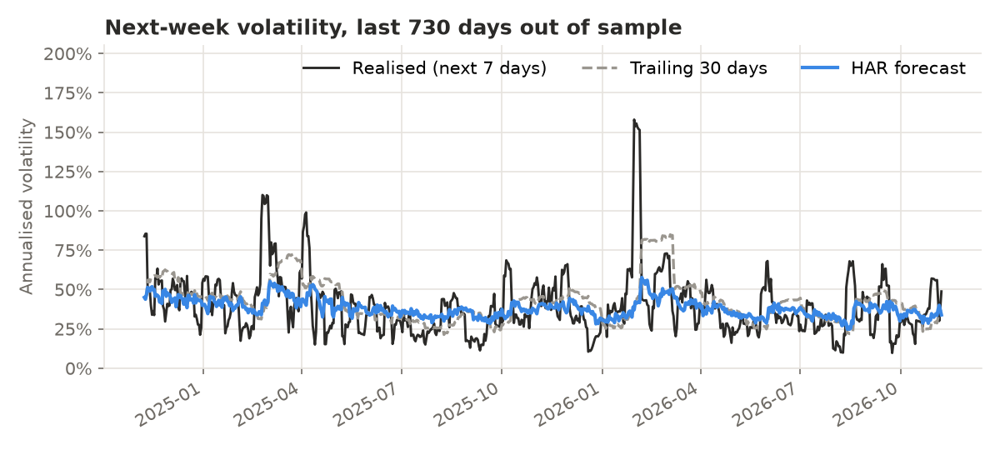
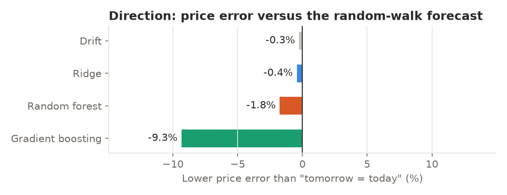
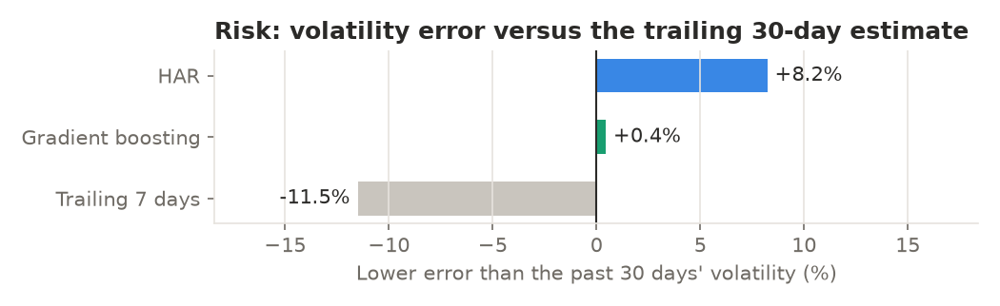

# Can you forecast Bitcoin?

Next-day Bitcoin forecasting with technical indicators, gold and Brent crude, tested the way a trading desk would test it: walk-forward, against naive baselines, with a significance test. The short answer: **the direction of tomorrow's price can't be predicted, but its risk can.**



## Findings

Out of sample, November 2017 → November 2026 (about 3,300 days). Every forecast was made by a model trained only on earlier data.

- **No model predicts the price better than "tomorrow = today".** Ridge regression, random forest and gradient boosting are all *worse* than this random-walk forecast (p < 0.01). They call the direction right 50% of the time. Long/cash strategies built on them earn less than buy-and-hold.
- **The R² of 0.997 reported in this project's course version measured nothing.** The random-walk forecast scores 0.998 on the same test, because a price that moves about 2% a day is always close to yesterday's.
- **Volatility is forecastable.** A HAR model, which combines daily, weekly and monthly realised volatility, beats the standard 30-day estimate by 8.2% (p = 0.00001). It also doubles the R², from 0.13 to 0.24. Gradient boosting on all 25 features does no better than the 30-day estimate.

<p>
  
  
</p>

The full tables are in [reports/results.md](reports/results.md). They include MAE, MAPE, R², direction hit rate, strategy returns and drawdowns.

## Run it

```bash
git clone https://github.com/kaang457/crypto_prediction && cd crypto_prediction
docker compose run --rm btcforecast             # walk-forward backtest, about 2 min; writes reports/
docker compose run --rm btcforecast download    # refresh data/market.csv from Yahoo Finance
```

Without Docker (Python 3.12+):

```bash
pip install -e ".[dev]"
btcforecast backtest
pytest
```

## How it is evaluated

- **Walk-forward.** Each model is trained on a rolling 3-year window and refit every 30 days. It only ever predicts days after its training window. The course version used a single 80/20 split and a shuffled K-fold, and both let a model learn from the future.
- **Purging.** The 7-day volatility target is only known a week later, so the six newest training rows are dropped before each forecast. One test removes this gap and checks that the leak is caught.
- **Stationary features.** The models see returns, ratios and oscillators, not price levels. A price-level model trained on 2017 prices cannot extrapolate to 2024 prices; the course notes describe this as the model getting "stuck at 65k".
- **No look-ahead in the data.** Gold and Brent trade on weekdays, so their closes are carried forward over weekends and never filled backward. One test rewrites the future and checks that no past feature changes.
- **Significance.** Diebold-Mariano tests with Newey-West variance check whether each model's error really differs from its baseline's.

## Repository

```
src/btcforecast/
  data.py       Yahoo Finance download, calendar alignment
  features.py   25 features and two targets (next-day return, next-week volatility)
  models.py     baselines, Ridge, random forest, gradient boosting, HAR
  backtest.py   walk-forward with purging
  metrics.py    error metrics, Diebold-Mariano, long/cash strategy after fees
  report.py     reports/results.md and figures
tests/          leakage, purging, metric and alignment tests
data/market.csv daily BTC, gold and Brent, 2014-09 → 2026-11
```

This started in 2025 as a course project built in notebooks; that version is kept on the [`course-version`](https://github.com/kaang457/crypto_prediction/tree/course-version) branch.

[MIT License](LICENSE)
